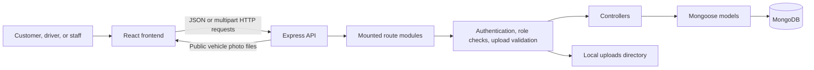

# RaahSetu – Logistics Platform

RaahSetu is a full-stack logistics web application for transport customers, drivers, and operations staff. Customers can create transport bookings; drivers can complete an onboarding profile and manage eligible loads; staff can review and coordinate operations. The application also includes vehicle listings and finance or insurance enquiry workflows.

## Table of Contents

- [Project Description](#project-description)
- [Problem Statement](#problem-statement)
- [Project Objectives](#project-objectives)
- [Key Features](#key-features)
- [User Roles and Permissions](#user-roles-and-permissions)
- [Technology Stack](#technology-stack)
- [System Architecture](#system-architecture)
- [Project Structure](#project-structure)
- [Application Workflow](#application-workflow)
- [Authentication and Authorization](#authentication-and-authorization)
- [OTP Verification Workflow](#otp-verification-workflow)
- [API Documentation](#api-documentation)
- [Database Models and Collections](#database-models-and-collections)
- [Installation and Setup](#installation-and-setup)
- [Environment Variables](#environment-variables)
- [Running the Application Locally](#running-the-application-locally)
- [Available Scripts](#available-scripts)
- [Screenshots](#screenshots)
- [Future Improvements](#future-improvements)
- [Contributors](#contributors)
- [License](#license)

## Project Description

The project has a React and CSS frontend in `client/` and an Express API in `server/`. The API uses MongoDB through Mongoose. The implemented workflows cover customer accounts and bookings, driver registration and document review, staff operations, vehicle listings and buyer interest, and finance or insurance enquiries.

The frontend calls the API with `fetch`. Its API server URL is currently set to `http://localhost:5001` in `client/src/services/api.js`.

## Problem Statement

The implemented workflows address the need to coordinate transport bookings, driver onboarding, load assignment, delivery status, and related vehicle enquiries in one application. This statement is inferred from the features in the source code; the repository does not include a separate product requirements document.

## Project Objectives

- Let customers submit transport bookings and review their booking history.
- Let drivers register, provide profile and verification details, and manage loads assigned to them.
- Give staff tools to review drivers, bookings, vehicle listings, and finance or insurance enquiries.
- Track load assignment, pickup confirmation, and delivery progress.
- Support vehicle listing submissions and buyer interest from authenticated customer and driver accounts.

## Key Features

- **Customer dashboard and profile:** customer session restoration, profile updates, booking access, and navigation to marketplace and enquiry screens. The API's customer overview endpoint currently returns placeholder counters and unavailable telemetry.
- **Booking management:** create bookings, list the signed-in customer's bookings, and view a booking by ID.
- **Driver onboarding:** phone OTP registration, profile and vehicle details, profile photo and document uploads, and staff verification.
- **Driver load management:** view approved, unassigned bookings for the driver's vehicle type, accept a load after approval, and advance delivery status.
- **Staff dashboard and operations:** database counts for pending drivers, loads, listings, and enquiries; driver, load, and listing review; document viewing; dispatch pickup confirmation; and enquiry status updates.
- **Vehicle listings:** authenticated customers and drivers can submit a listing with four photos, browse approved listings, and register buyer interest. The code does not implement checkout or a vehicle sale transaction.
- **Finance and insurance enquiries:** authenticated customers and drivers can submit enquiries; staff can review and update their status. The code does not calculate finance offers or issue insurance policies.
- **Public information:** public platform information and service-list endpoints.

## User Roles and Permissions

| Role | Sign-in method | Verified permissions |
| --- | --- | --- |
| Visitor | None | Read public platform information and services; request customer or driver login/registration OTPs; access sign-in screens. |
| Customer | Phone OTP | Manage customer profile; create and view own bookings; browse and list vehicles; register vehicle interest; submit finance or insurance enquiries. |
| Driver | Phone OTP | Complete driver profile and uploads; view available and accepted loads; submit enquiries and vehicle listings. Only staff-approved drivers can accept loads or update delivery status. |
| Staff | Gmail address and password | View operational statistics; verify drivers and bookings; review vehicle listings and buyer interests; manage enquiries; confirm pickup. Staff accounts are created with the backend setup script. |

## Technology Stack

| Layer | Technologies used |
| --- | --- |
| Frontend | React 19, JavaScript (ES modules), CSS, Vite 8 |
| Backend | Node.js, Express 5 (CommonJS) |
| Database | MongoDB with Mongoose 9 |
| Authentication | `jsonwebtoken` JWTs; `bcryptjs` password hashing for staff |
| OTP | Node.js `crypto`; OTP state is held in a server-process `Map` |
| File uploads | Multer; files are stored on the server's local filesystem |
| Other backend packages | `cors`, `dotenv` |
| Development tools | Nodemon on the backend; ESLint on the frontend |

The frontend package also includes React type packages and ESLint plugins as development dependencies. The application code is JavaScript; it is not a TypeScript project.

## System Architecture



The frontend and backend are separate packages. The frontend currently calls the backend at `http://localhost:5001`; the backend connects to MongoDB before it starts listening. Driver documents and profile photos are served through authenticated API routes. Vehicle listing photos are served from the public `/uploads/vehicle-photos/` path.

## Project Structure

```text
.
├── .gitignore
├── README.md
├── client/
│   ├── .gitignore
│   ├── README.md
│   ├── package.json
│   ├── package-lock.json
│   ├── eslint.config.js
│   ├── vite.config.js
│   ├── index.html
│   ├── public/
│   │   ├── favicon.svg
│   │   └── icons.svg
│   └── src/
│       ├── App.jsx
│       ├── App.css
│       ├── index.css
│       ├── main.jsx
│       ├── services/api.js
│       ├── assets/
│       │   ├── hero.png
│       │   ├── react.svg
│       │   └── vite.svg
│       └── components/
│           ├── BookTransport.jsx
│           ├── BookingHome.jsx
│           ├── BuyVehicles.jsx
│           ├── CustomerDashboard.jsx
│           ├── CustomerLogin.jsx
│           ├── CustomerProfile.jsx
│           ├── DriverDashboard.jsx
│           ├── DriverDocuments.jsx
│           ├── DriverLogin.jsx
│           ├── DriverOtpVerification.jsx
│           ├── DriverPersonalInfo.jsx
│           ├── DriverRegistration.jsx
│           ├── DriverRegistrationOtp.jsx
│           ├── DriverVehicleDetails.jsx
│           ├── FinanceEnquiry.jsx
│           ├── MyBookings.jsx
│           ├── OtpVerification.jsx
│           ├── SellVehicle.jsx
│           ├── StaffDashboard.jsx
│           ├── StaffDispatchManagement.jsx
│           ├── StaffDriverVerification.jsx
│           ├── StaffFinanceEnquiries.jsx
│           ├── StaffLoadVerification.jsx
│           ├── StaffLogin.jsx
│           ├── StaffVehicleInterests.jsx
│           └── StaffVehicleReview.jsx
└── server/
    ├── .env.example
    ├── package.json
    ├── package-lock.json
    ├── server.js
    └── src/
        ├── config/db.js
        ├── controllers/
        │   ├── authController.js
        │   ├── bookingController.js
        │   ├── customerController.js
        │   ├── driverAuthController.js
        │   ├── driverController.js
        │   ├── driverDocumentController.js
        │   ├── driverLoadController.js
        │   ├── financeEnquiryController.js
        │   ├── staffAuthController.js
        │   ├── staffDashboardController.js
        │   ├── staffDispatchController.js
        │   ├── staffDriverController.js
        │   ├── staffDriverDocumentController.js
        │   ├── staffFinanceController.js
        │   ├── staffLoadController.js
        │   ├── staffVehicleController.js
        │   └── vehicleListingController.js
        ├── middleware/
        │   ├── authMiddleware.js
        │   ├── driverAccessMiddleware.js
        │   ├── staffAuthMiddleware.js
        │   ├── uploadMiddleware.js
        │   └── uploadVehiclePhotos.js
        ├── models/
        │   ├── Booking.js
        │   ├── Customer.js
        │   ├── Driver.js
        │   ├── FinanceEnquiry.js
        │   ├── Staff.js
        │   └── VehicleListing.js
        ├── routes/
        │   ├── authRoutes.js
        │   ├── bookingRoutes.js
        │   ├── customerRoutes.js
        │   ├── dashboardRoutes.js
        │   ├── driverAuthRoutes.js
        │   ├── driverRoutes.js
        │   ├── financeEnquiryRoutes.js
        │   ├── publicRoutes.js
        │   ├── staffAuthRoutes.js
        │   ├── staffDashboardRoutes.js
        │   ├── staffDispatchRoutes.js
        │   ├── staffDriverRoutes.js
        │   ├── staffFinanceRoutes.js
        │   ├── staffLoadRoutes.js
        │   ├── staffVehicleRoutes.js
        │   └── vehicleListingRoutes.js
        ├── scripts/createStaff.js
        └── services/otpService.js
```

The tree shows the application and configuration files; operating-system `.DS_Store` metadata files are omitted. The backend `controllers/`, `middleware/`, `models/`, and `routes/` directories contain the modules for the customer, driver, staff, booking, marketplace, and enquiry workflows. There is no root-level `package.json`; install and run each package separately.

## Application Workflow

1. A customer requests and verifies a phone OTP. On the first successful verification, the API creates the customer record and returns a JWT.
2. The customer creates a booking. New bookings start as pending and await staff verification.
3. Staff approves or rejects the booking. Approved, unassigned bookings become available to approved drivers whose vehicle type matches the booking's truck type.
4. An approved driver accepts a matching load. The booking moves to `assigned`.
5. Staff records pickup confirmation. The assigned driver can then move the load to `in-transit` and subsequently `delivered`.
6. A new driver requests and verifies a registration OTP, completes profile and vehicle details, and uploads the required documents. Staff can approve or reject the application.
7. A customer or driver may submit a vehicle listing with front, back, left, and right photos. Staff reviews it; approved listings can be browsed and interested buyers are visible to staff.
8. A signed-in customer or driver can submit a finance or insurance enquiry. Staff can move its status through the supported workflow.

## Authentication and Authorization

- Customer and driver API requests use `Authorization: Bearer <token>`.
- Customer and driver tokens contain the account ID and role, use the `HS256` algorithm, and expire after one day.
- Staff sign-in uses an email and password. The password is compared with a `bcryptjs` hash, and the resulting staff JWT also expires after one day.
- Staff routes use staff-specific middleware that verifies the JWT and checks that the staff account exists and is active.
- Driver routes check the driver role. Load acceptance and delivery-status updates also require an approved driver account.
- The frontend stores separate customer, driver, and staff tokens in browser `localStorage` and restores sessions on app load.
- There is no server-side logout endpoint; the frontend clears the local session when the user signs out.

## OTP Verification Workflow

Customer login, existing-driver login, and new-driver registration each have request and verification endpoints. OTP values are six digits, generated with Node.js `crypto`, stored in memory, expire after five minutes, allow at most five verification attempts, and are removed after successful use.

In non-production mode, the OTP is printed in the backend terminal. No SMS or email delivery provider is configured in this repository. In production mode the code suppresses the terminal log, but it still does not send the OTP to the user; production OTP delivery must be integrated before production authentication can work end to end.

## API Documentation

Base URL for local development: `http://localhost:5001`. All routes below are mounted by `server/server.js`.

For protected routes, send `Authorization: Bearer <token>` using the token for the role listed. JSON bodies use `Content-Type: application/json`; upload routes use `multipart/form-data`. Fields marked optional can be omitted unless a note says otherwise.

### Public and customer routes

| Method | Endpoint | Purpose | Authentication | Request |
| --- | --- | --- | --- | --- |
| `GET` | `/` | Backend status response | None | None |
| `GET` | `/api/public/info` | Read platform information | None | None |
| `GET` | `/api/public/services` | Read the service list | None | None |
| `POST` | `/api/auth/request-otp` | Request a customer OTP | None | JSON: `phone` (10-digit string) |
| `POST` | `/api/auth/verify-otp` | Verify OTP and sign in/create customer | None | JSON: `phone`, `otp` (6-digit string) |
| `GET` | `/api/customer/dashboard/overview` | Read customer overview | Customer JWT | None; response currently contains fixed zero counters and unavailable telemetry |
| `GET` | `/api/customer/profile` | Read signed-in customer's profile | Customer JWT | None |
| `PUT` | `/api/customer/profile` | Update customer profile | Customer JWT | JSON: `name` and/or `email`; at least one field |
| `POST` | `/api/customer/bookings` | Create a transport booking | Customer JWT | JSON: `pickupLocation`, `dropLocation`, `pickupDate` (`YYYY-MM-DD`), `pickupTime` (`HH:mm`), `goodsType`, `goodsWeightKg`, `truckType` (`mini-truck`, `light-truck`, or `heavy-truck`) |
| `GET` | `/api/customer/bookings` | List signed-in customer's bookings | Customer JWT | None |
| `GET` | `/api/customer/bookings/:id` | Read one of the customer's bookings | Customer JWT | Path parameter: booking `id` |

### Driver routes

| Method | Endpoint | Purpose | Authentication | Request |
| --- | --- | --- | --- | --- |
| `POST` | `/api/driver/auth/request-otp` | Request OTP for an existing driver | None | JSON: `phone` (10-digit string) |
| `POST` | `/api/driver/auth/verify-otp` | Verify driver login OTP | None | JSON: `phone`, `otp` |
| `POST` | `/api/driver/auth/registration/request-otp` | Request OTP for a new driver registration | None | JSON: `phone` (10-digit string) |
| `POST` | `/api/driver/auth/registration/verify-otp` | Verify OTP and create the initial driver account | None | JSON: `phone`, `otp` |
| `GET` | `/api/driver/profile` | Read driver profile | Driver JWT | None |
| `PUT` | `/api/driver/profile` | Update personal profile fields | Driver JWT | JSON fields: `name`, `email`, `dateOfBirth`, `gender`, `bio`, `address` (partial update) |
| `PUT` | `/api/driver/vehicle-details` | Update driving and vehicle details | Driver JWT | JSON fields: `experienceYears`, `vehicleType`, `vehicleModel`, `vehicleNumber`, `licenseNumber`, `panNumber` (partial update) |
| `POST` | `/api/driver/profile-photo` | Upload driver profile photo | Driver JWT | Multipart file field: `profilePhoto` |
| `GET` | `/api/driver/profile-photo` | Read own profile photo | Driver JWT | None; returns a file |
| `POST` | `/api/driver/documents` | Upload driver verification documents | Driver JWT | Multipart file fields: `license`, `vehicleRC`, `identity`; these documents are required for staff approval |
| `GET` | `/api/driver/loads` | List approved, unassigned loads matching driver vehicle type | Driver JWT | None |
| `PATCH` | `/api/driver/loads/:id/accept` | Accept an available load | Approved driver JWT | Path parameter: booking `id`; no body |
| `GET` | `/api/driver/my-loads` | List driver's accepted loads | Driver JWT | None |
| `PATCH` | `/api/driver/loads/:id/status` | Update assigned delivery status | Approved driver JWT | JSON: `status` (`in-transit` or `delivered`); transitions are checked by the API |

### Marketplace and finance routes

| Method | Endpoint | Purpose | Authentication | Request |
| --- | --- | --- | --- | --- |
| `POST` | `/api/vehicle-listings` | Submit a vehicle listing | Customer or driver JWT | Multipart fields: `vehicleType` (`mini-truck`, `light-truck`, or `heavy-truck`), `vehicleModel`, `vehicleNumber`, `rcNumber`, `contactName`, `contactPhone`; one image each in file fields `front`, `back`, `left`, `right` |
| `GET` | `/api/vehicle-listings` | Browse approved vehicle listings | Customer or driver JWT | None |
| `POST` | `/api/vehicle-listings/:listingId/interest` | Register interest in a listing | Customer or driver JWT | Path parameter: `listingId`; no body |
| `POST` | `/api/finance-enquiries` | Submit finance or insurance enquiry | Customer or driver JWT | JSON: `enquiryType` (`finance` or `insurance`), `applicantName`, registered `phone`, `vehicleType` (`mini-truck`, `light-truck`, or `heavy-truck`), `rcNumber` |

### Staff routes

| Method | Endpoint | Purpose | Authentication | Request |
| --- | --- | --- | --- | --- |
| `POST` | `/api/staff/auth/login` | Sign in staff account | None | JSON: `email`, `password` |
| `GET` | `/api/staff/dashboard/stats` | Read operational counts | Staff JWT | None |
| `GET` | `/api/staff/drivers/pending` | List pending driver applications | Staff JWT | None |
| `GET` | `/api/staff/drivers/:driverId/documents/:documentType` | View an uploaded driver document or photo | Staff JWT | Path `documentType`: `profilePhoto`, `license`, `vehicleRC`, or `identity`; returns a file |
| `PATCH` | `/api/staff/drivers/:driverId/verification` | Approve or reject driver application | Staff JWT | JSON: `status` (`approved` or `rejected`), optional `remarks` (required when rejecting) |
| `GET` | `/api/staff/loads/pending` | List bookings awaiting staff verification | Staff JWT | None |
| `PATCH` | `/api/staff/loads/:bookingId/verification` | Approve or reject booking | Staff JWT | JSON: `status` (`approved` or `rejected`), optional `remarks` (required when rejecting) |
| `GET` | `/api/staff/vehicles/pending` | List vehicle listings awaiting review | Staff JWT | None |
| `GET` | `/api/staff/vehicles/buyer-interests` | List approved listings and interested buyers | Staff JWT | None |
| `PATCH` | `/api/staff/vehicles/:listingId/review` | Approve or reject vehicle listing | Staff JWT | JSON: `status` (`approved` or `rejected`), optional `remarks` (required when rejecting) |
| `GET` | `/api/staff/finance-enquiries` | List finance and insurance enquiries | Staff JWT | None |
| `PATCH` | `/api/staff/finance-enquiries/:enquiryId/status` | Change enquiry status | Staff JWT | JSON: `status` (`reviewing`, `contacted`, or `closed`), subject to allowed transitions |
| `GET` | `/api/staff/dispatch` | List driver-accepted loads | Staff JWT | None |
| `PATCH` | `/api/staff/dispatch/:bookingId/confirm-pickup` | Record pickup confirmation | Staff JWT | JSON: optional `remarks` |

### Static vehicle photos

`GET /uploads/vehicle-photos/:filename` serves vehicle listing photos without authentication. Driver documents and profile photos are not served from this public path.

## Database Models and Collections

Mongoose creates the following default collections from the models in `server/src/models/`:

| Model | Collection | Stored information |
| --- | --- | --- |
| `Customer` | `customers` | Name, unique phone number, email, and customer role. |
| `Driver` | `drivers` | Contact and personal profile, vehicle and license details, verification state, and uploaded document/photo metadata. |
| `Staff` | `staffs` | Name, unique Gmail address, bcrypt password hash, and active state. |
| `Booking` | `bookings` | Customer reference, pickup/drop details, goods and truck details, booking and verification status, driver assignment, and pickup confirmation. |
| `VehicleListing` | `vehiclelistings` | Seller reference, vehicle details, photo paths, review state, and interested buyers. |
| `FinanceEnquiry` | `financeenquiries` | Customer/driver requester reference, finance or insurance type, applicant and vehicle details, and enquiry status. |

All models use Mongoose timestamps. Upload metadata is stored in MongoDB; uploaded files themselves are stored under the backend process's `uploads/` directory.

## Installation and Setup

### Prerequisites

- Node.js `^20.19.0` or `>=22.12.0`. These versions satisfy the backend and Vite 8 engine requirements.
- npm
- A MongoDB instance, local or hosted
- Git

### Clone the repository

Replace `<repository-url>` with the URL for your repository:

```bash
git clone <repository-url>
cd raahsetu-logistics-platform
```

### Install dependencies

The frontend and backend have separate lockfiles and dependencies:

```bash
cd client
npm ci

cd ../server
npm ci
```

### Configure MongoDB and environment

Make sure your MongoDB instance is running or that your hosted database is reachable. From the `server/` directory, copy the safe template and edit the local values:

```bash
cp .env.example .env
```

Set `MONGO_URI` to your MongoDB connection string and set a private `JWT_SECRET`. Do not commit `server/.env`. The root `.gitignore` excludes `.env` files while allowing `.env.example` templates.

## Environment Variables

| Variable | Required | Purpose |
| --- | --- | --- |
| `MONGO_URI` | Yes | MongoDB connection string. The server exits if it is missing or the connection fails. |
| `JWT_SECRET` | Yes for authentication | Secret used to sign and verify JWTs. Use a long, random value and keep it private. |
| `PORT` | No | Backend port; defaults to `5001`. The frontend currently targets port `5001`, so changing this alone will prevent the frontend from reaching the API. |
| `CORS_ORIGINS` | No | Comma-separated allowed frontend origins. Defaults to `http://localhost:5173,http://localhost:3000`; set the deployed frontend origin in production. |
| `NODE_ENV` | No | Set to `production` to suppress development OTP logging and enable the production CORS configuration warning. It does not configure OTP delivery. |

Use [`server/.env.example`](server/.env.example) as the local template. It contains placeholders only.

## Running the Application Locally

Start the backend in one terminal:

```bash
cd server
npm run dev
```

The server connects to MongoDB and then listens at `http://localhost:5001`. A simple status response is available at `http://localhost:5001/`.

Start the frontend in a second terminal:

```bash
cd client
npm run dev
```

Open the local URL printed by Vite, normally `http://localhost:5173`.

To create the first staff account, run this from `server/` after configuring MongoDB and `server/.env`:

```bash
node src/scripts/createStaff.js
```

The script prompts for a name, Gmail address, and password. It hashes the password before saving the account. The password must be at least eight characters.

## Available Scripts

| Package | Command | Description |
| --- | --- | --- |
| `client` | `npm run dev` | Start the Vite development server. |
| `client` | `npm run build` | Build the frontend for production into `client/dist/`. |
| `client` | `npm run preview` | Preview the built frontend locally. |
| `client` | `npm run lint` | Run ESLint over the client project. |
| `server` | `npm run dev` | Start the Express server with Nodemon. |
| `server` | `npm start` | Start the Express server with Node.js. |

There is no root package script and neither package currently defines a test script.

## Screenshots

No application screenshots are included in the repository. Add screenshots here when they are available.

## Future Improvements

The following are possible next steps, not implemented features:

- Integrate an SMS or other OTP delivery provider and use a shared, persistent OTP store for production.
- Replace the customer dashboard overview placeholders with live booking and dispatch data.
- Add automated backend and frontend test suites.
- Configure the frontend API base URL for non-local deployments.
- Consider durable object storage for uploads when deploying multiple backend instances.

## Contributors

No contributor names are documented in the repository. Add project contributors here when confirmed.

## License

`server/package.json` declares the ISC license. The repository does not currently include a top-level `LICENSE` file, so the project-wide license has not been confirmed.
